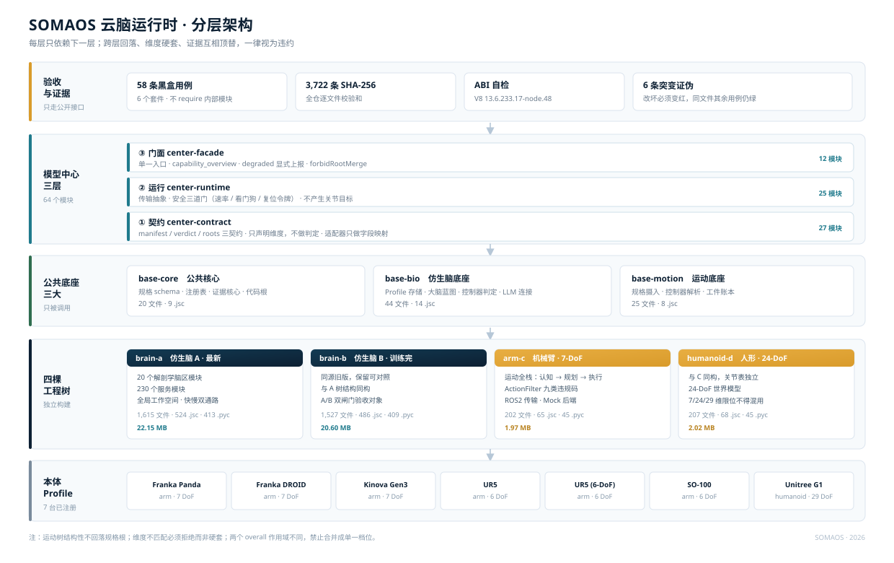

<div align="center">

# SOMAOS 云机器人大脑

**面向实体机器人（人形 / 机械臂 / 轮式）的云脑运行时**

四棵工程树 · 三大底座 · 三层模型中心 · 七台本体 Profile

<p>


</p>

</div>

---

## 这是什么

SOMAOS 不是单个视觉-语言-动作（VLA）模型，而是**把异构模型组织成一套可调度、可降级、可验收的大脑运行时**。

机器人厂商真正缺的通常不是模型，而是三件事：

1. **把模型装进本体** —— 规格摄入、能力判定、Profile 落盘；
2. **让多个模型在同一块 GPU 上协同** —— 调度、抢占、显存回收、表征桥接；
3. **证明它真的能跑** —— 可复现的验收，而不是一段演示视频。

本仓库交付的是这三件事的**可运行产物**：10 个 dist、3,704 个发布文件、58 条黑盒验收用例。

| 维度 | 规模 |
|---|---|
| 工程树 | 4 棵（仿生脑 A/B、运动脑 C/D），可独立构建、独立验收、独立升级 |
| 脑区模块 | 20 个以解剖学命名的功能脑区 + 核心装配 / 记忆 / 感知 / 训练四类基础设施 |
| 服务模块 | `brain-a` 单树 230 个服务模块 |
| 公共底座 | 3 个（公共核心、仿生脑底座、运动脑底座） |
| 模型中心 | 3 层（契约 / 运行 / 门面），共 64 个模块 |
| 本体 Profile | 7 台（Franka、Kinova、UR5、SO-100、G1 29-DoF 等） |
| 验收 | 58 条黑盒用例 + 3,731 条 SHA-256 + 突变证伪 |

> **交付形态**：JavaScript 编译为 V8 字节码（`.jsc`），Python 编译为 sourceless `.pyc`，不含明文源码、不含模型权重、不含第三方二进制。这是**发布件**，不是源码仓库。

---

## 架构总览



自上而下五层，每层只依赖下一层，**不允许跨层回落**：

```
┌────────────────────────────────────────────────────────────────┐
│  验收与证据   58 黑盒 · 3,731 SHA-256 · ABI 自检 · 突变证伪    │
├────────────────────────────────────────────────────────────────┤
│  模型中心 ③ 门面  center-facade   单一入口 / 能力总览          │
│           ② 运行  center-runtime  监督 / 传输 / 安全三道门     │
│           ① 契约  center-contract 只声明维度，不做判定         │
├────────────────────────────────────────────────────────────────┤
│  公共底座  base-core   规格 / 注册表 / 证据 / 代码根           │
│            base-bio    仿生脑底座   base-motion 运动底座       │
├────────────────────────────────────────────────────────────────┤
│  工程树    brain-a 仿生脑最新   brain-b 仿生脑训练完           │
│            arm-c 机械臂 7-DoF    humanoid-d 人形 24-DoF        │
├────────────────────────────────────────────────────────────────┤
│  本体      7 台 Profile（arm / humanoid 两族）                 │
└────────────────────────────────────────────────────────────────┘
```

**四条设计约束**（在代码与契约里都写成不变量，不只是文档口号）：

- 契约层**只追加** `verdict`，绝不改写 `readiness`
- 两个 `overall` 作用域不同（A/B/C/D 全项目 vs 仅 C/D），**禁止合并成单一档位**
- 适配器**只做字段映射，不做判定**
- 运动树**结构性不回落**规格根，维度不匹配必须拒绝而不是硬套

---

## 仓库结构

```
.
├── dist/                 10 个可独立运行的发布单元
│   ├── brain-a/          仿生脑 A（最新版）        1,615 文件 · 22.15 MB
│   ├── brain-b/          仿生脑 B（训练完版）      1,527 文件 · 20.60 MB
│   ├── arm-c/            运动脑 C（机械臂 7-DoF）    202 文件 ·  1.97 MB
│   ├── humanoid-d/       运动脑 D（人形 24-DoF）     207 文件 ·  2.02 MB
│   ├── base-core/        大底座公共核心              20 文件
│   ├── base-bio/         仿生脑大底座                44 文件
│   ├── base-motion/      运动脑大底座                25 文件
│   ├── center-contract/  模型中心 · 契约层           27 文件
│   ├── center-runtime/   模型中心 · 运行层           25 文件
│   └── center-facade/    模型中心 · 门面             12 文件
├── acceptance/           发布件形态验收（7 条）+ 驱动器；其余 51 条随评估包
├── scripts/              ABI 自检
├── docs/                 架构 / 模型中心 / 能力模型 / 验收方法
└── sha256sums.txt        全仓 3,731 条校验和
```

### dist 一览

| dist | 定位 | 文件 | 体积 | `.jsc` | `.pyc` |
|---|---|---|---|---|---|
| `brain-a` | 仿生脑主工程（最新） | 1,615 | 22.15 MB | 524 | 413 |
| `brain-b` | 仿生脑主工程（训练完版·旧） | 1,527 | 20.60 MB | 486 | 409 |
| `arm-c` | 运动脑：7-DoF 机械臂全栈 | 202 | 1.97 MB | 65 | 45 |
| `humanoid-d` | 运动脑：24-DoF 人形全栈 | 207 | 2.02 MB | 68 | 45 |
| `base-core` | 规格 / 注册表 / 证据 / 代码根 | 20 | 0.12 MB | 9 | — |
| `base-bio` | 仿生脑底座：Profile、蓝图、LLM 连接 | 44 | 0.28 MB | 14 | — |
| `base-motion` | 运动脑底座：规格摄入、控制器判定 | 25 | 0.13 MB | 8 | — |
| `center-contract` | 契约层：manifest / verdict 三契约 | 27 | 0.10 MB | 11 | — |
| `center-runtime` | 运行层：传输、监督、状态上报 | 25 | 0.14 MB | 11 | — |
| `center-facade` | 门面：统一入口与能力总览 | 12 | 0.07 MB | 4 | — |

---

## 模型中心：三层架构

这是整套系统的**中枢设计**。模型中心不训练模型，它负责回答三个问题：*能装什么、怎么跑、现在到底行不行*。

### ① 契约层 `center-contract`

**只声明，不判定。** 三份契约固化了跨模块的数据形状：

| 契约 | 作用 |
|---|---|
| `manifest.v1.json` | 云脑清单的字段与枚举（`embodimentId` / `dof` / `state` / `commands` / `safety` / `interfaces` / `readiness`） |
| `verdict.v1.json` | 三维度判定契约：`driveEvidence`（全项目）、`motionSelfSufficiency`（仅 C/D）、`commandable`（仅运行态） |
| `roots.v1.json` | 代码根与证据根的声明 |

关键设计：**契约层不计算任何判定，只声明它存在且归谁计算**。适配器（`adapters/bio.js`、`adapters/motion.js`、`adapters/runtime.js`）只做字段映射，一旦出现「基于 bio 与 motion 取值做条件分支」就是违约。

### ② 运行层 `center-runtime`

**只监督，不产生关节目标。** 六个模块各管一件事：

| 模块 | 职责 |
|---|---|
| `safetySupervisor.js` | 三道门：速率限制 → 看门狗 → 复位令牌 |
| `executionTransport.js` | 传输层抽象（`null` / `loopback` / 真实），未探活一律不算 real |
| `manifestSource.js` | 从契约层取清单，不缓存判定 |
| `cloudServiceLayer.js` | 云服务编排 |
| `statusReport.js` | 运行态上报（`supervision-only` 作用域） |
| `runtime.js` | 生命周期与状态机 |

`readiness = real` 的充分条件是**存在真实且已探活的传输层**；只有 loopback 时输出 `blocked / CLOUD_UNCONFIGURED`，而不是假装就绪。

### ③ 门面 `center-facade`

**单一入口，显式降级。** `overview()` 把七台本体的 bio / motion 结果并排合成，用 `embodiment.id` 作连接键，并强制 `forbidRootMerge`——两棵树的证据不允许互相顶替。任何证据根缺失都会让 `degraded = true`，且 `requireMissingRootsEmpty` 为真时直接拒绝出结论。

> 详细规格见 [docs/MODEL_CENTER.md](docs/MODEL_CENTER.md)。

---

## 能力模型

系统对外只讲**档位**，不讲形容词。

### 三维判定

| 维度 | 作用域 | 枚举 |
|---|---|---|
| `driveEvidence` | 全项目 A/B/C/D | `vendor-controller` / `joint-target-driver` / `no_transport_driver` / `none` |
| `motionSelfSufficiency` | 仅 C/D 运动树 | `ready-real` / `ready-sim` / `needs-training` / `unsupported` |
| `commandable` | 运行态实时 | `true` / `false` |

### 已注册本体（7 台）

| Profile | 族 | DoF |
|---|---|---|
| Franka Emika Panda | arm | 7 |
| Franka（DROID 变体） | arm | 7 |
| Kinova Gen3 | arm | 7 |
| Universal Robots UR5 | arm | 6 |
| UR5（6-DoF 变体） | arm | 6 |
| SO-100 开源臂 | arm | 6 |
| Unitree G1 | humanoid | 29 |

> 判定语义与降级规则见 [docs/CAPABILITY_MODEL.md](docs/CAPABILITY_MODEL.md)。

---

## 验收与证据

`acceptance/` 只通过发布件**公开的路径与接口**访问被测系统——不 require 内部模块，不读私有字段。

全套 **58 条**分六个套件。其中 `02`–`06` 的用例代码描述了各条安全链的判定顺序与违约码语义，属于受控内容，**随评估包单独提供**；本仓库只保留 `01_packaging`，它的作用是"防自己"：

| 套件 | 用例 | 覆盖 | 随仓库 |
|---|---|---|---|
| `01_packaging` | 7 | 10 个 dist 完整、1,200 对 stub/`.jsc`、912 个 `.pyc`、无明文源码、无未掩码用户名、ABI 自检 | 是 |
| `02_brain_ab` | 9 | 仿生脑侧安全门与生命支持：判定边界、急停锁存与恢复、看门狗通道行为、A/B 语义一致 | 否 |
| `03_motion_cd` | 14 | 运动脑侧：急停与复位令牌、动作过滤各类违约、Mock 后端与执行桥、世界模型维度与数值有效性 | 否 |
| `04_bases` | 12 | 三底座：规格硬校验、证据原语、控制器解析在缺证据时的降级（含负结果对照） | 否 |
| `05_centers` | 13 | 模型中心三层：契约层并排合成、运行层监督生命周期、门面缺证据时的降级上报 | 否 |
| `06_python` | 3 | `.pyc` magic、sourceless 导入、docstring 已剥除 | 否 |
| **合计** | **58** | | |

```bash
npm test                                                    # 7 条（发布件形态）
node acceptance/run-one.js acceptance/01_packaging.test.js   # 单组
node scripts/verify-abi.js                                   # ABI 自检，退出码 0
```

除黑盒用例外，发布流程还保留 **6 条突变证伪**记录：每条语义突变只让指定用例转红，同文件其余用例仍绿——用来证明验收套件真的能抓到错误，而不是一片绿。

> 方法论见 [docs/VERIFICATION.md](docs/VERIFICATION.md)。

---

## 快速开始

```bash
npm install          # 只装 bytenode
node scripts/verify-abi.js
npm test
```

零依赖起步（不接硬件，默认 Mock 后端）：

```bash
cd dist/arm-c        && node src/index.js     # 7-DoF 机械臂运动脑
cd dist/humanoid-d   && node src/index.js     # 24-DoF 人形运动脑
```

仿生脑需要先装依赖：

```bash
cd dist/brain-a && npm install && node index.js
```

缺 `onnxruntime` / `sharp` 等原生依赖时，相关感知能力会**显式降级并上报**，不会静默假装成功。

---

## 环境要求（硬性）

| 项 | 要求 | 原因 |
|---|---|---|
| Node | **v24.15.0**（V8 13.6.233.17-node.48） | `.jsc` 与 V8 版本强绑定，其他版本无法加载 |
| Python | **3.11.x**（构建于 3.11.9，magic `a70d0d0a`） | `.pyc` 为 sourceless 字节码，验收按 magic 判定 |
| 依赖 | 根目录 `npm install` | 仅 `bytenode`，见 [NOTICE.md](NOTICE.md) |

`.jsc` 换 Node 版本必须重新构建——这是 bytenode 的固有约束，不是配置问题。

### 环境变量

| 变量 | 作用 | 缺省行为 |
|---|---|---|
| `SOMAOS_SAFETY_RESET_TOKEN` | C/D 急停复位令牌 | 未设置时**拒绝复位**，急停保持闭锁 |
| `SOMAOS_BASE_CORE` | 指定 `base-core` 目录 | 自动找同级 `dist/base-core` |
| `SOMAOS_BRAIN_ROOT` | 含 `opencastor/embodiment` 的代码根 | 自动找同级 `dist/brain-a` |
| `SOMAOS_MOTION_SPEC_ROOT` | 运动底座规格根 | 同上（只取关节表，不作证据） |
| `SOMAOS_CENTER_CONFIG` | 中心配置路径 | `dist/center-facade/config/center.config.json` |
| `SOMAOS_PYTHON` | 验收脚本解释器 | 依次找 Python 3.11 / `python3` / `python` |

---

## 安全须知

本软件**可直接驱动物理执行器**。

- 上机前必须确认急停链路可用：触发后 `/goal`、`/robot/command`、`/ai/chat`、`/data-plane/execute` 全部拒绝，复位需操作员令牌。
- 不含权重时，学习/推理相关能力处于降级态。**不要在降级态下做高速或载人动作。**
- 世界模型评估的碰撞概率与能量必须为有限数，非有限值一律拒绝执行。
- 无遥测、无回连：本发布件不向任何外部地址发送数据（除你自行配置的模型服务）。

详见 [SECURITY.md](SECURITY.md)。

---

## 范围与限制

发布件刻意**不含**以下内容，原因一并列出——这些不是遗漏，是设计选择：

| 排除项 | 原因 |
|---|---|
| 模型权重（`.pt` / `.onnx` / `.npz` / `.safetensors`） | 本发布为无权重版；含权重将改变许可与体积性质 |
| 第三方二进制（CUDA/ggml DLL、electron、STL 网格） | 体积超限，且 NVIDIA EULA / 上游许可禁止再分发 |
| `gush3r/`（croco 权重与代码） | 上游 CC BY-NC-SA 4.0，与本发布许可不兼容 |
| 明文设计文档、白盒测试 | 会等价泄露设计；验收改用黑盒套件 |
| 运行时数据（`memory_store/`、监控转储） | 含本机运行痕迹 |
| 本机绝对路径 | 已机械改写为仓内相对路径，用户名段等长掩码 |

### 保护强度（如实说明）

已做：标识符十六进制重命名、字符串入表并 base64、注释与格式剥离、V8 字节码封装、Python docstring 剥除。

**做不到的**：

1. **成员属性名不会被重命名**（如 `lifeSupport.signalEmergencyStop`）——全程序属性改名对安全链风险过高，故不做，字节码中仍可提取这些名字。
2. `.jsc` / `.pyc` 都可被反编译或 dump 出结构。**混淆只提高成本，不等于加密。** 真正不可逆的方案只有服务端托管。
3. `.jsc` 与 Node/V8 版本绑定，换版本必须重新构建。

---

## 文档

| 文档 | 内容 |
|---|---|
| [docs/ARCHITECTURE.md](docs/ARCHITECTURE.md) | 四树 / 三底座 / 三中心的完整分层与依赖规则 |
| [docs/MODEL_CENTER.md](docs/MODEL_CENTER.md) | 模型中心三层规格、契约字段、不变量 |
| [docs/CAPABILITY_MODEL.md](docs/CAPABILITY_MODEL.md) | readiness / verdict 语义与降级阶梯 |
| [docs/VERIFICATION.md](docs/VERIFICATION.md) | 黑盒验收方法论、突变证伪、校验流程 |
| [CHANGELOG.md](CHANGELOG.md) | 发布变更记录 |
| [CONTRIBUTING.md](CONTRIBUTING.md) | 本仓库为二进制发布，贡献与反馈方式 |

---

## 许可

[SomaOS 二进制评估与使用许可](LICENSE)：允许评估、研究与非商业集成；**禁止逆向/反混淆/反编译**，禁止以源码形态再分发，商业使用需另行授权。第三方组件见 [NOTICE.md](NOTICE.md)。

---

<div align="center">
<sub>SOMAOS · 云机器人大脑运行时 · 2026</sub>
</div>
